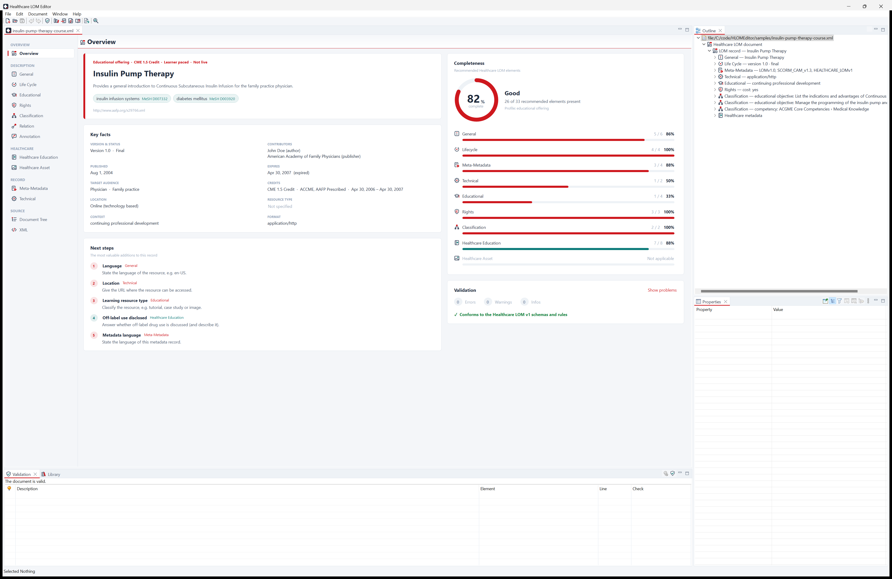
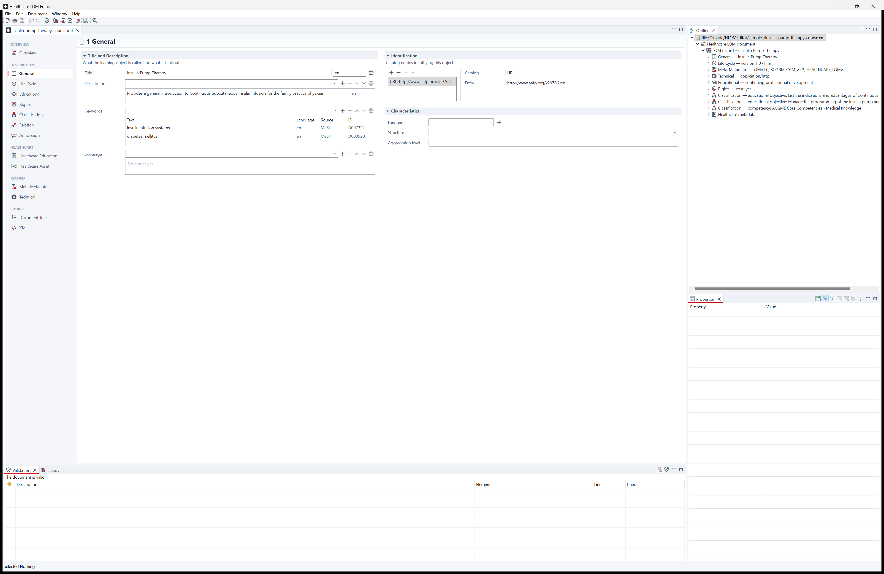
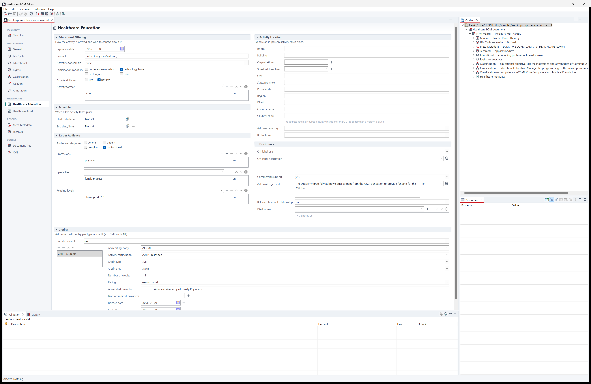
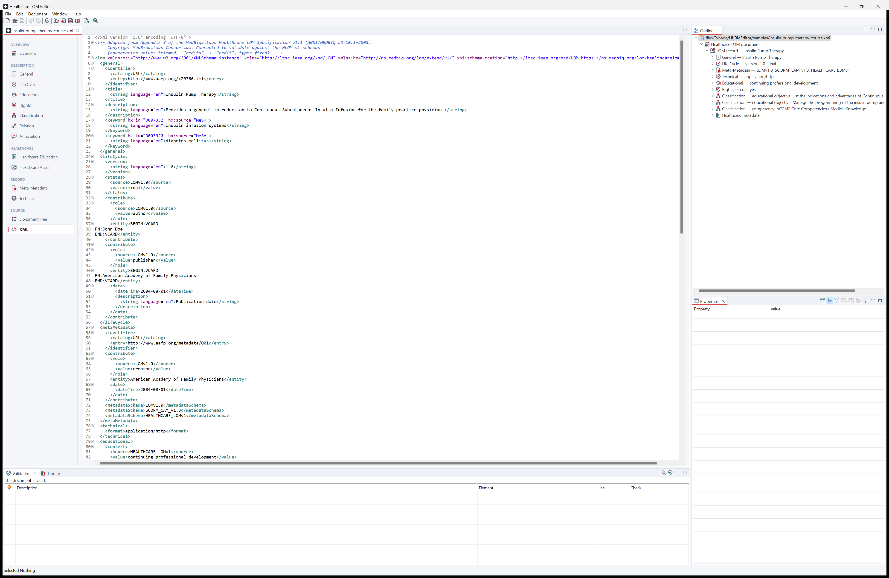
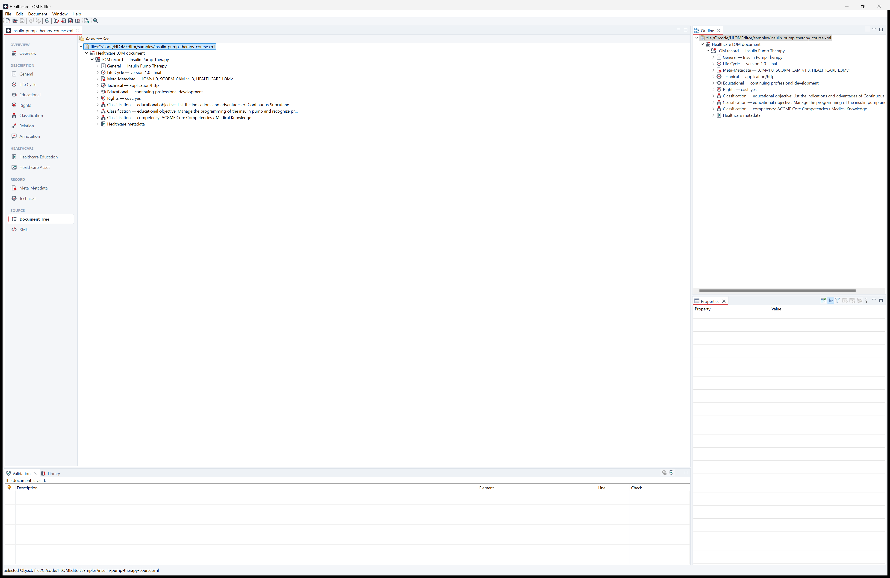

# Hermes 2: MedBiquitous Editor

A desktop editor for the **MedBiquitous standards** of health professions education: Healthcare Learning Object
Metadata (HLOM) v1 — ANSI/MEDBIQ LO.10.1-2008, the healthcare profile of IEEE LOM for continuing-education
courses, live activities and medical image assets — and the Curriculum Inventory, Competency Framework, Competency
Object, Performance Framework, Activity Report, Medical Education Metrics, Healthcare Professional Profile and
Virtual Patient standards.

Ravi Teja Bhupatiraju, University of Louisiana at Lafayette, Center for Applied Artificial Intelligence (CAAI). Built with Eclipse RCP,
EMF and Eclipse Nebula.



## Standards

| Standard | Versions | Root element |
| --- | --- | --- |
| Healthcare LOM | 1.0 (XML and JSON) | `lom` |
| Curriculum Inventory | 1.0, "v10" (AAMC 2022 point release) | `CurriculumInventory` |
| Competency Framework, Competency Object, Performance Framework | 1.0 | `CompetencyFramework`, `CompetencyObject`, `PerformanceFramework` |
| Activity Report | 1.0, 2.0 | `ActivityReports` |
| Medical Education Metrics (MEMS), MEMS Survey Items | 1.0 | `MedicalEducationMetrics`, `SurveyItems` |
| Healthcare Professional Profile (with Name and Address) | 1.0 | `Members` |
| Virtual Patient: Data, Activity Model, Data Availability Model | 1.0 | `VirtualPatientData`, `ActivityModel`, `DataAvailabilityModel` |

Every document type has form pages, the document tree and the XML page with schema-aware content assist, a
template for new documents, samples, validation against the published schemas (bundled, offline) and the
standard's rules (in the editor, the Problems view, the command line tool and the language server), search,
comparison and help. Healthcare LOM additionally has the JSON form, the MeSH and terminology lookups, quick fixes,
the completeness assessment, the library and HTML reports, and the CSV import.

Not included: the working drafts MedBiquitous never published (HLOM 2.0, Curriculum Inventory 2.0, Professional
Profile 2.0, Disclosure 1.0, MEMS 2.0); Disclosure of Interests 2.0 and Educational Achievement 1.0, whose schemas
import schemas that are no longer published (MedBiquitous Common v3; PESC Core Main 1.12.0 and Academic Record
1.7.0); and Educational Trajectory and xAPI, which have no schemas of their own. See
[docs/medbiq-expansion.md](docs/medbiq-expansion.md).

## Highlights

**Start page and templates**
- Branded start page with quick actions, recent documents and an introduction to HLOM.
- New-document wizard with a template gallery: blank record, CME course, medical image asset, patient education
  resource and live workshop — each a complete, schema-valid starting point. Optionally records you (from the
  preferences) as author and metadata creator.
- Bundled sample records (spec-derived and fictional demonstration records), plus a deliberately broken record in
  `samples/invalid/` to try the repair workflow.

**Projects**
- **Projects view**: manage many records together. A project is a folder of HLOM documents (XML and JSON) with a
  small project file (`hermes-project.json`: name, description, format of new documents); every HLOM document
  below the folder belongs to the project, also files added outside the application.
- The tree shows folders and documents with their titles and validation state (validated in the background,
  re-checked after saving) and per-project counts of documents and documents with errors.
- Create projects (*File > New > Project…* or the start page) or open any folder as a project; create documents in a
  project, add existing documents (also by dropping files on the view), create folders, rename (F2), move documents
  and folders by dragging them, delete documents and folders, close projects (the files stay on the disk), convert
  documents between XML and JSON, show them in the file explorer, and edit the project's properties. Creating
  folders, renaming, moving and deleting can be undone (*Edit > Undo* while the view is active; deleted files are
  kept in the local history).
- The view is an Eclipse Common Navigator: *Link with Editor*, *Collapse All*, *Navigate > Show In > Projects*, a
  filter for folders without documents (*View Menu > Filters and Customization*), and the Team menu and Git
  decorations of shared projects.
- **Problems view**: the problems of all project documents (XML Schema, constraints and rules), validated in the
  background whenever a document changes (also outside the application); double-click opens the field. *Quick Fix*
  (Ctrl+1 or the context menu) offers the editor's fixes, also for many problems at once (*Select All* in the Quick
  Fix dialog): documents open in an editor are fixed there (undoable), other documents are fixed and saved (the
  previous version stays in the local history).
- Documents, folders and projects with problems carry an error or warning overlay (a workbench decorator: *Preferences
  > General > Appearance > Label Decorations*).
- The standard workbench entry points: *File > New > Other…* (Document, Project; created where the selection is),
  *File > Export…* (*HTML Reports*: a catalog card per document and a library report; *Documents as XML or JSON*:
  converted copies keeping the folder structure) and *File > Properties* (Alt+Enter) with the project's page.
- **Search** (*Search > Search Documents…*, Ctrl+H): find text or a regular expression in the field values of the
  documents of the workspace, the selected projects, the selection or working sets; optionally case sensitive or
  whole words, and limited to titles, descriptions, keywords, contributors and sponsors, identifiers and locations,
  classifications, credits and accreditation or audience. Attribute values (such as MeSH ids) are searched too,
  documents with unsaved changes are searched as edited, and the Search view lists the matching fields per
  document with the matches highlighted; opening one shows the field in the editor.
- **Replace**: *Replace…* in the search dialog, or *Replace All…* / *Replace Selected…* in the Search view, replaces
  the matches in the field values (with a regular expression, `$1`, `$2`… insert its groups). The changes are
  previewed per document before they are applied and undone together with *Edit > Undo*; only the changed values are
  rewritten (the layout and comments of XML documents stay as they are), and values that would become invalid (such
  as dates) are left alone and listed.

**References**
- References between the elements of a document (Curriculum Inventory events, sequence blocks, competency objects
  and academic levels; Performance Framework components and scales) are chosen from the elements they can name:
  the form shows the referenced element by its title (*Ctrl+click* or the arrow button goes there), and the list
  offers the possible targets instead of XPath text. On the XML page, *Ctrl+click* on a reference goes to its
  target.
- *Search > References in Document* (Ctrl+Shift+G) lists the references to the selected element in the Search view;
  *Edit > Rename Identifier* (Alt+Shift+R) renames an event's, block's or scale's identifier and updates every
  reference in one undoable step.
- Documents refer to each other by identifier: a competency framework includes competency objects by URI, a learning
  object relates to other resources, a Curriculum Inventory lists competency objects. The background validation
  indexes the identifiers of the project documents, so *Ctrl+click* on such an identifier on the XML page opens the
  document it names, and *Search > Referring Documents* lists the documents that refer to the open one.

**Document views** (*Window*)
- **Document Graph** (Eclipse GEF Zest): the elements of the active document and the references between them — the
  sequence blocks of a Curriculum Inventory with their events, nested blocks, competency objects and academic
  levels; the components and scales of a performance framework; the competencies of a framework with their broader,
  narrower and related competencies. Layered, tree, radial or spring layout, kinds of elements can be hidden, zoom;
  double-click shows an element in the editor.
- **Curriculum Timeline** (Eclipse Nebula Gantt chart): the sequence blocks of a Curriculum Inventory on a calendar,
  one section per academic level, with the dated events of each block.
- **Document Lists** (Eclipse NatTable): any list of the document (events, sequence blocks, competency objects,
  components, ...) as a table with a column per field; simple values are edited in the cells (undoable), and
  double-clicking a row number shows the item.

**XML and JSON**
- Documents are stored as XML or, for files with the extension `.json`, in a JSON form following the naming of the
  [MedBiquitous Healthcare LOM JSON Schema](https://www.medbiq.org/standards/healthcare-learning-object-metadata):
  elements are members named after the element, repeatable elements (in the LOM binding, almost all) are arrays,
  multilingual text is `{"language": "en", "content": "…"}`, vocabulary values are written as
  `{"source": [{"content": "LOMv1.0"}], "value": [{"content": "author"}]}` (the compact
  `{"source": "LOMv1.0", "value": "author"}` is accepted when reading), and the document carries `"$schema"`. The conversion is driven by the EMF model generated from the HLOM XML Schemas, so
  it is lossless and restores the schema's element order; JSON documents are validated exactly like XML ones
  (XML Schema, constraints and rules), with load problems reported at JSON lines.
- The published JSON Schema set is incomplete (most referenced component schemas are not published and several
  references don't resolve), so it is referenced but not used for validation.
- Every document has a **JSON page** next to the XML page (highlighting, live syntax checking, formatting with
  Ctrl+Shift+F); edits are applied when leaving the page or saving. *Save As* with a `.json` or `.xml` name
  converts a document, and the new-document wizard and the preferences let you choose the format of new
  documents.

**Offline terminologies**
- Complete terminologies ship with the application and are searched without a network connection:
  **MeSH 2026** (all 31,110 descriptors with entry terms, scope notes, tree numbers and see-also references),
  **ICD-10-CM FY2026** (all chapters, blocks, categories and codes, including 7th-character codes, with inclusion
  terms), the **ACGME core competencies**, the **revised Bloom's taxonomy** and the **AAMC/MedBiquitous
  Curriculum Inventory** instructional methods, assessment methods and resource types.
- *Add MeSH Keywords* and the MeSH lookup answer from the offline index (the NLM service is only an opt-in
  fallback for descriptor IDs newer than the index). Keyword lists have a *Look Up* button for coded keywords
  (MeSH, ICD-10-CM); classification taxon paths can be filled from any of the terminologies (source plus the
  concept's path in the hierarchy).
- The lookup dialog browses the hierarchy or searches codes, names and synonyms, with definitions, synonyms,
  hierarchy and related concepts. Validation warns about codes that don't exist in the terminology.
- MeSH and ICD-10-CM are installed as features of their own, versioned by their release (2026.0.0): a new yearly
  release is installed with *Help > Check for Updates* without a new version of the application.
- SNOMED CT and LOINC require a license of each user and are not included. With the API key of your own UMLS
  license (free from the NLM; *Preferences > Healthcare LOM > Terminologies*, with a *Test* button), they are
  searched online in the same lookups; the key is kept encrypted in the Eclipse secure storage (protected by the
  operating system's key store where there is one). Sources, regeneration and
  license notices: `bundles/edu.louisiana.caai.lom.model/terminology-src/README.md` and *Preferences >
  Healthcare LOM > Terminologies*.

**Editing**
- **Overview dashboard**: hero card with kind, credits and MeSH-coded keywords, key facts, a completeness score
  with per-category progress (recommended elements based on the HLOM specification), validation summary and
  "next steps" linking to the right page.
- **Navigation sidebar** grouping the pages (Description, Healthcare, Record, Source) with problem badges.
- **Data-bound form pages** for every LOM category and the healthcare extensions (General, Life Cycle,
  Educational, Rights, Classification, Relation, Annotation, Healthcare Education, Healthcare Asset,
  Meta-Metadata, Technical):
  - vocabulary fields with the IEEE LOM and MedBiquitous healthcare terms (grouped), writing the matching
    `source`;
  - multilingual text with an inline language and a translations dialog;
  - date pickers (Nebula CDateTime), token chips for value lists (Nebula Chips), compact icon toolbars,
    auto-sizing lists, master/detail blocks for contributors, credits, classifications and more;
  - suggestions from the specification (professions, specialties, accrediting bodies, credit categories,
    reading levels, MIME types, terminologies) and help from the specification on every field;
  - inline validation markers on the affected fields.
- **MeSH lookup**: search the Medical Subject Headings (offline), view scope notes, tree numbers and synonyms,
  and add keywords with `hx:source="MeSH"` and the descriptor id.
- **Document tree** with Outline and Properties views for every element, including custom extensions.
- **XML page** with syntax highlighting, live XML Schema checking (squiggles, hovers, overview ruler),
  schema-aware content assist (Ctrl+Space: elements, vocabulary terms, enumeration values, language tags),
  formatting (Ctrl+Shift+F), comment toggling (Ctrl+/), matching-tag highlight and folding. Text changes are
  applied to the model when leaving the page or saving; broken files open with their original text for repair.
- One undo/redo history across all pages and views; clearing a field removes elements that became empty;
  merely viewing a document never changes it.

**Quality**
- **Validation view**: XML Schema errors (bundled HLOM schemas, works offline), EMF constraints and HLOM rules
  (conformance requirements such as `metadataSchema` LOMv1.0 + HEALTHCARE_LOMv1 and `healthcareMetadata`, plus
  consistency checks for credits, dates, disclosures, languages and MeSH ids). Double-click reveals the element.
- **Quick fixes**: a light bulb marks fixable problems; Ctrl+1 or the context menu applies a fix (add the
  required metadata schemas or `healthcareMetadata`, set missing languages, swap inverted dates, reconcile
  credit flags) or jumps to the field that needs attention; *Fix All* repairs everything automatic in one
  undoable step.
- **Compare**: field-by-field semantic comparison of two records (or of the editor against the saved file —
  ideal for reviewing unsaved changes), grouped by category with added/removed/changed highlighting; repeated
  elements are matched by meaning (keywords by MeSH id, credits by type, texts by language), so reordering is
  not reported as a change.
- The same comparison is the content viewer of the Eclipse compare framework for MedBiquitous documents: *Compare
  With > Each Other* and *Local History* in the Projects view, and the history, staging and Synchronize views of Git
  show the changed fields; *Switch Compare Viewer* in the compare editor offers the text comparison for merging.
- **Metadata Library**: scan a folder of records, search/filter by kind and status, statistics (records,
  errors, credits offered), completeness column, open, revalidate and export.
- **HTML reports**: a printable catalog card per record and a sortable library report.
- **Import from CSV**: turn a spreadsheet into records (see below).

### Import from CSV

*File > Import from CSV…* creates one Healthcare LOM record per spreadsheet row.

1. Choose the CSV (comma, semicolon, tab or `|` delimited; UTF-8, UTF-16 or Windows-1252, all detected
   automatically) and the template every record starts from.
2. Check the column mapping: headers such as "Title", "Course Code", "Credits", "CME Credits", "Specialties"
   or "hx:creditType" are recognized automatically; any column can be mapped to one of 65 HLOM fields.
3. Review the generated records: each is validated against the HLOM schemas and rules; friendly values are
   interpreted ("self-paced" → learner paced, "CT" → computed axial tomography scan, "90" → PT1H30M) and every
   interpretation is listed. Uncheck rows you don't want.
4. Choose the folder and a file name pattern (`{title}`, `{n}-{title}`, `{id}`, `{column:Header}`, …).
   Existing files are never overwritten unless you ask. The folder can be shown in the Library and the first
   record opened.

Tips: separate several values in a cell with `;` (e.g. `physician; registered nurse`); credit columns take one
value per credit (`CME; CNE` with `1.5; 2`); tag keywords with MeSH descriptors as `Sepsis [MeSH:D018805]`;
write contributors as `Name <email>`. A complete example is `samples/import/courses.csv` (six fictional
courses and assets).

**Versions and other metadata**
- *File > Convert to Newer Version…* writes a Curriculum Inventory 1.0 report as the AAMC point release v10 (the
  level of each sequence block becomes its starting and ending academic level) and an Activity Report 1.0 as 2.0 (the
  reporting period is derived from the activities; identifier domains get the `idd:` form; the new member schema's
  licensing body name and license number availability are filled in). Everything is copied by name into the new
  version's model, the original file is not changed, and what remains to be done (such as the participants of
  Activity Report 2.0) is listed.
- *File > Export… > Metadata Crosswalks* writes Healthcare LOM records as unqualified Dublin Core (`oai_dc`, for
  OAI-PMH repositories) and as schema.org JSON-LD (a `Course` with its credits and MeSH terms as `DefinedTerm`s, for
  web pages, search engines and learning registries).

**Updates**
- *Help > Check for Updates* and *Help > Install New Software…* (Eclipse p2) update the application and the
  terminologies from an update site; *Preferences > Install/Update* schedules automatic checks. The release build
  writes the update site to `dist/Hermes2-<version>-update-site.zip`; unzip it on a web server and set its address
  with `-Dhermes.update.site=<address>` in `Hermes2.ini` or the `edu.louisiana.caai.lom.editor/updates.site`
  preference (`plugin_customization.ini`), or add it in *Preferences > Install/Update > Available Software Sites*.

**Help and settings**
- **Cheat sheets** (*Help > Cheat Sheets…*): guided workflows whose steps run the application's commands —
  describing a course with Healthcare LOM, preparing a Curriculum Inventory report, repairing an invalid document,
  keeping the terminologies current.
- **Error Log** (*Window > Error Log*): the messages and errors of the application, to copy or export for support.
- **User Guide** (*Help > User Guide*): the Eclipse help system with a task-oriented guide (getting started,
  concepts, tasks, reference: editor pages, views, menus and shortcuts, validation rules and quick fixes, JSON
  format, project file, terminologies), full-text help search, a keyword index and context help: **F1** shows the
  help of the focused field, page, view or dialog in the Help view.
- **HLOM Guide**: an in-app guide to the standard (categories, healthcare extensions, vocabularies,
  conformance checklist, credit acronyms, professions & specialties, using the editor) with search;
  Shift+F1 opens the topic of the focused field. The specification PDF is included.
- **Preferences**: default language, format of new documents (XML or JSON), author (vCard), validation behaviour,
  MeSH online fallback, and the included terminologies with their versions and license notices.
- Toast notifications, splash screen, application icons and a custom workbench theme.

### Command line and language server

The same checks run outside the editor with the `hermes` command (in the `cli` folder of the installation, or the
separate `hermes-cli-<version>.zip` for any system with Java 25+; the Windows installer can add it to the `PATH`):

```
hermes validate <file|folder>...        check documents; --format text|json|sarif, --output, --min-severity,
                                        --fail-on error|warning|never (exit code 1 when problems are found)
hermes convert <input> [<output>]       XML <-> JSON (--to xml|json, --force)
hermes format <file>... [--check]       rewrite in the canonical layout (or only report, for CI)
hermes fix <file>... [--dry-run]        apply the automatic quick fixes
hermes search <text> <file|folder>...   find text in field values (--regex, --case-sensitive, --whole-word,
                                        --in titles,keywords,...)
hermes replace <text> <with> <path>...  replace text in field values (same options, --dry-run)
hermes migrate <input> [<output>]       convert to the newer version of the standard
hermes crosswalk <input> [<output>]     a Healthcare LOM record as Dublin Core or schema.org (--to dc|schema.org)
hermes info <file>...                   title, kind, keywords, contributors, credits, audience and problems
hermes lsp                              the language server (Language Server Protocol over stdio)
```

Problems are reported at their line and column in the file as written (XML and JSON), the same as in the Problems
view: the editor's background validation, the command line tool and the language server share one check
(`DocumentCheck`). SARIF output can be uploaded to code scanning (for example GitHub's `upload-sarif` action).

The **language server** validates MedBiquitous documents while they are edited in any editor with LSP support
(other XML and JSON files are left alone): diagnostics, quick fixes and *fix all*, hovers with the field help,
formatting and an outline. `clients/vscode/` is a small Visual Studio Code extension that starts it.

### Hermes 2 Web

`hermes-web-<version>.zip` (built in `releng/edu.louisiana.caai.lom.web.product`) is a small web server (Equinox,
Jetty) with the documents in the browser, built with Eclipse RAP: unpack it and run `hermes-web` (or `sh hermes-web`,
`hermes-web.cmd` on Windows; Java 25+), then open `http://localhost:8080/hermes` (another port with
`HERMES_WEB_PORT`). It creates documents of every standard or opens them from the computer (XML or JSON), shows the
elements as a tree and the fields of the selected element as a form (with the vocabulary of enumerations; elements
are added and removed there), checks the document after every change — the same XML Schema and rules as the desktop
application, the command line tool and the language server, because the web edition is built on the same model
bundles — and downloads it as XML (or JSON). Each browser session has its own document; nothing is stored on the
server. The form pages, views and editors of the desktop application need SWT and the Eclipse IDE and are not part of
the web edition; it is built against its own target platform (`releng/edu.louisiana.caai.lom.web.target`, RAP 4.8),
since RAP replaces SWT.

## Screenshots

| | |
| --- | --- |
|  |  |
|  |  |
|  |  |

Regenerate them with `powershell -ExecutionPolicy Bypass -File docs\capture-screenshots.ps1` (and `-StartPage`
for the start page) after building.

## Repository layout

| Path | Contents |
| --- | --- |
| `xsd/` | HLOM v1 schemas and specification as downloaded from medbiq.org (unchanged), plus the published Address schema (`xsd/ns.medbiq.org/address/v1/`) |
| `bundles/edu.louisiana.caai.lom.model` | EMF model generated from the schemas (`model/hlom.genmodel`, `src-gen/`) and OSGi-free support code (`src/.../model/support`: loading/saving (XML and JSON), projects, validation and rules, vocabularies, suggestions, templates, completeness, MeSH client, reports and library scanning) |
| `bundles/edu.louisiana.caai.lom.edit` | Generated EMF item providers |
| `bundles/edu.louisiana.caai.lom.editor` | The application: generated advisor/editor (`src-gen`) and hand-written UI (`src`): `binding` (EMF ↔ data binding), `forms`, `pages`, `xml`, `json`, `projects`, `validation`, `start`, `wizards`, `library`, `mesh`, `help`, `preferences` |
| `tests/edu.louisiana.caai.lom.tests` | Headless JUnit 5 plug-in tests (model, JSON form, offline terminologies, validation, rules, templates, completeness, MeSH client, quick fixes, diff, CSV import, reports, labels, editing commands) |
| `tests/edu.louisiana.caai.lom.ui.tests` | UI integration tests in a real workbench (Tycho UI harness): page activation without side effects, form editing with undo/redo and save, XML and JSON page round trips, broken-file repair, quick fixes, Projects view, views and preference pages |
| `bundles/edu.louisiana.caai.medbiq.model` | The other MedBiquitous standards: their schemas (`schemas/`, as published), Ecore models (`model/`, dynamic EMF), document types and per-standard content (`standards/`: titles, form pages, rules, search fields, field help), templates and samples |
| `bundles/edu.louisiana.caai.lom.help` | The user guide of the Eclipse help system: table of contents, topics (`html/`), context help (`contexts.xml`; field contexts generated by `help-src/gen_contexts.py`) and keyword index |
| `bundles/edu.louisiana.caai.lom.cli` | The `hermes` command line tool and the language server (plain Java, no OSGi) |
| `releng/` | Target platform (Eclipse 2026-09 + EMF + Nebula + help system), feature and product (`Hermes2`), and `edu.louisiana.caai.lom.cli.dist` (the `hermes` launchers, jars and `hermes-cli` zip) |
| `clients/vscode/` | Visual Studio Code extension for the language server |
| `tools/schematool` | Converts the MedBiquitous schemas to the Ecore models of the standards bundle (`mvnw -f tools/schematool/pom.xml compile exec:java`) |
| `tools/dev-hermes.sh` | Runs the command line tool with the working copy of the standards bundle (no Maven build) |
| `xsd/mirror/` | A mirror of the published MedBiquitous schemas (`ns.medbiq.org`) and the W3C and Dublin Core schemas they import |
| `samples/` | Sample HLOM documents |
| `docs/` | Specification extraction (`hlom-spec-notes.md`), screenshots and tooling |

## Build

Requirements: a JDK 25+, Inno Setup 6 for the
Windows installer, and internet access for the first build (Tycho downloads the target platform).
The Maven wrapper downloads Maven 3.9.16.

```sh
mvnw.cmd clean verify        # Windows
./mvnw clean verify          # Linux / macOS / Git Bash
```

This compiles everything, runs the tests and assembles the products in
`releng/edu.louisiana.caai.lom.product/target/products/` (Tycho's working archives and unpacked installs).

### Release archives

```sh
mvnw.cmd -Prelease clean verify     # Windows
./mvnw -Prelease clean verify       # Linux / macOS / Git Bash
```

writes the release files to `dist/` (replacing its previous contents):

| File | Format |
|---|---|
| `Hermes2-1.0.0-windows-x64-setup.exe` | Windows installer (Inno Setup), standalone: includes the Java runtime |
| `Hermes2-1.0.0-windows-x64.7z` | only when Inno Setup is not available: the standalone Windows build as an archive (7z, LZMA2, solid) |
| `Hermes2-1.0.0-linux-x64.tar.xz` | tar with xz compression |
| `Hermes2-1.0.0-update-site.zip` | the update site (p2 repository) for *Help > Check for Updates* |
| `Hermes2-1.0.0-macos-arm64.tar.gz` | tar with gzip compression (opens with a double-click in Finder) |
| `hermes-cli-1.0.0.zip` | the command line tool and language server alone (any system with Java 25+) |
| `hermes-web-1.0.0.zip` | Hermes 2 Web, the server of the documents in the browser (any system with Java 25+) |
| `SHA256SUMS` | checksums; verify with `sha256sum -c SHA256SUMS` |

- All builds are **standalone**: they include the Java runtime of Eclipse JustJ (OpenJDK 27 without debug
  symbols), a root feature of the product that sets `-vm` in `Hermes2.ini`; new Java releases come with *Help >
  Check for Updates* like the rest of the application.
- The installer is compiled with Inno Setup 6 (found in its usual install locations or on the `PATH`; or pass
  `-Discc=<path to ISCC.exe>`; without it the installer is skipped with a warning). It installs for all users or,
  if chosen, for the current user only, adds a Start menu entry (optionally a desktop shortcut) and an
  uninstaller. The script and wizard images are in `releng/edu.louisiana.caai.lom.product/installer/`.
- The Windows archive is built with 7-Zip at maximum compression when it is installed (in
  `%ProgramFiles%\7-Zip` or on the `PATH`; or pass `-Dsevenzip=<path to 7z>`). Without 7-Zip, a built-in
  writer is used; it produces a valid 7z archive about 5% larger.
- The tar archives set Unix permissions explicitly (executable launchers and native libraries) and a neutral
  owner, so they are correct even when the release is built on Windows. Tycho's own tar archives built on
  Windows lack the executable bits.
- The archives contain plug-in jars that are already compressed, so stronger compression saves only about
  5-8% over zip/tar.gz.
- The macOS app is not signed or notarized. After downloading, macOS may report it as damaged; remove the
  quarantine attribute with `xattr -cr Hermes2.app`, or sign and notarize it with an Apple Developer ID.

## Run

On Windows, run the installer or unpack the archive and start `Hermes2.exe`; no Java installation is needed.
On Linux and macOS, unpack the archive and start `Hermes2` or `Hermes2.app`; no Java installation is needed
either.

The workspace (preferences, open projects, window layout) is `~/.hermes2/workspace`, so the application also
works when installed in a read-only folder. The status bar shows the memory in use (Eclipse's heap status);
click its trash can to run the garbage collector.

During development, `run.cmd` (in the repository root) starts the last build (building it first if there is
none) with the workspace `workspace\` next to it:

```
run                 start the last build
run -build          rebuild (tests skipped), then start
run -fresh          start with an empty workspace
```

Double-clicked in Explorer, `run.cmd` continues without a console window: a build writes its output to
`run-build.log` and a failure is shown in a message box. It starts Hermes 2 with the Java in `JAVA_HOME`
(Java 25 or later) if set, else with the first Java on the `PATH`.

`build.cmd` and `test.cmd` build and test separately (a failed build or test ends with exit code 1):

```
build               build the application and write the release files to dist\ (tests skipped)
build -app          build the application only (what run.cmd starts)
build -clean        remove the previous build output first
test                the unit tests (fast, no windows)
test -ui            the unit and user interface tests (the test window opens off-screen)
test -show          like -ui, with the test window on screen
test -only "A,B"    only the given test classes, e.g. test -only FormLayoutTest
```

Both take `-offline` (use only the local Maven repository). `build` stops when Hermes 2 is running, since the
running application locks the files of its build; `test` doesn't rebuild the product, so it also works then.
`build` builds the modules in parallel and shows its progress, with Maven's full output in `build.log`;
double-clicked, it keeps its window open at the end.

## Architecture

- **Model**: generated with the EMF XSD importer from `model/schema/healthcarelom.xsd` (a copy of `xsd/` whose
  Address import points to the bundled published Address schema). The IEEE LOM binding uses unbounded choices,
  so most features are derived from a feature map and preserve element order and extension content.
- **Edit/Editor**: generated EMF edit and RCP editor code. Customizations of generated code are marked
  `@generated NOT`; hand-written code lives in `src/`, so the model can be regenerated.
- **Form binding** (`editor/binding`): JFace Data Binding properties that read along a `ModelPath` (creating
  missing elements on first edit) and write by executing EMF commands on the editor's command stack. One
  content adapter (`ModelChangeBroadcaster`) notifies the bound observables after each change.
- **Why the Eclipse 3.x compatibility layer?** The editor needs a multi-page editor, the Properties view,
  the Outline, text editor infrastructure and EMF's generated editor framework. None of these exist in a pure
  E4 application: `MultiPageEditorPart`/`FormEditor`, `PropertySheetPage`, `ContentOutlinePage` and
  `AbstractTextEditor` are 3.x workbench APIs, EMF's code generator only targets IDE, RCP, RAP and GWT (no
  e4 option), and `org.eclipse.emf.edit.ui`/`org.eclipse.emf.common.ui` require `org.eclipse.ui`. The
  compatibility layer runs on the E4 runtime (the Eclipse IDE is built the same way). See
  [GenRuntimePlatform](https://github.com/eclipse-emf/org.eclipse.emf/blob/master/plugins/org.eclipse.emf.codegen.ecore/src/org/eclipse/emf/codegen/ecore/genmodel/GenRuntimePlatform.java),
  [EMF edit.ui manifest](https://github.com/eclipse-emf/org.eclipse.emf/blob/master/plugins/org.eclipse.emf.edit.ui/META-INF/MANIFEST.MF)
  and the [compatibility layer overview](https://wiki.eclipse.org/Eclipse4/RCP/Compatibility_Layer/Overview).
- **Workspace** (`editor/workspace`): Hermes projects are Eclipse workspace projects (`org.eclipse.core.resources`)
  with the Hermes nature. Their content stays in the project folder anywhere on the disk, and their name,
  description and format stay in `hermes-project.json`. The workspace writes a `.project` file next to it.
  The nature's builder validates changed documents in the background and reports their problems as markers in
  the Problems view (`org.eclipse.ui.ide`); it also keeps an in-memory index of the documents (titles, problems,
  summaries). Documents of projects open as workspace files, so selecting a marker jumps to the field. The
  workspace (`~/.hermes2/workspace`) is refreshed automatically when files change outside the application.
  Projects that earlier versions kept in the preferences are moved into the workspace on the first start.
- The XML page builds on `org.eclipse.ui.workbench.texteditor`.
- Community components: [Eclipse Nebula](https://eclipse.dev/nebula/) (CDateTime, Chips, Badged Label, Opal
  Notifier/TitledSeparator/TextAssist, Gantt Chart), [NatTable](https://eclipse.dev/nattable/) (with Eclipse
  Collections, whose implementation the OSGi ServiceLoader mediator Apache Aries SPI Fly registers; both are started
  in the product configuration) and [GEF Classic Zest](https://github.com/eclipse/gef-classic).

## Regenerating the model

Open the projects in the *Eclipse Modeling Tools*, open
`bundles/edu.louisiana.caai.lom.model/model/hlom.genmodel` and choose *Generate Model/Edit/Editor Code*.
Hand-written code in `src/` and `@generated NOT` members are preserved. Notes:

- The generated editor would re-register the `Healthcare`/`Address` editors in the editor `plugin.xml`;
  remove them again.
- `model/lom.ecore` carries a manual change (keyword `source`/`id` mapped to the `hx` namespace) and the
  packages use the prefixes `hx`, `a` and `hv`; re-importing the XSD (*Reload...*) loses these edits.

## Translations

The texts of the application are externalized the Eclipse way, so translations are language fragments that need no
change of the application:

- menus, views, commands, preference pages and wizards: `plugin.properties` of each bundle;
- the texts of dialogs, forms and messages: `messages.properties` next to the `Messages` class (Eclipse NLS) of each
  package of the editor (`bundles/edu.louisiana.caai.lom.editor/src/.../messages.properties`);
- the user guide and cheat sheets: the `nl/<language>/` folder of the help bundle.

A translation is a fragment per bundle (for example `edu.louisiana.caai.lom.editor.nl_es`, `Fragment-Host:
edu.louisiana.caai.lom.editor`) with the translated files named `plugin_es.properties` and
`.../messages_es.properties`, installed like the terminology features (a feature on the update site). Properties files
are ISO-8859-1: other characters are written as `\uXXXX`. The validation messages and the help texts of the standards
(model bundles, also used by the command line tool) are in English, and some sentences built from several parts are
still in the code.

## Java runtime

The product includes the JustJ runtime `org.eclipse.justj.openjdk.hotspot.jre.full.stripped` from
`https://download.eclipse.org/justj/jres/27/updates/release/latest/` (see the target platform). As the JustJ
documentation describes, `target-platform-configuration` resolves without the build's own Java
(`<resolveWithExecutionEnvironmentConstraints>false</resolveWithExecutionEnvironmentConstraints>` and the
`org.eclipse.justj.buildtime=true` profile property). For another Java release, change the repository (e.g.
`jres/28`).

## Native image (future)

The model support code (`model/support`) doesn't depend on OSGi: `HlomResources.initStandalone()` registers
packages and the resource factory statically, schemas are read from the class path, validation uses JAXP and
the MeSH client uses `java.net.http`. This core can be reused in a GraalVM native image (for example a
command-line validator or report generator). A native image of the full Equinox/OSGi RCP application is not
practical because OSGi loads bundles dynamically.

## Develop in the Eclipse IDE

1. Use *Eclipse IDE for RCP and RAP Developers* (or Modeling Tools).
2. *File > Import > Existing Projects into Workspace*, select this folder and search nested projects.
3. Open `releng/edu.louisiana.caai.lom.target/edu.louisiana.caai.lom.target.target` and click
   *Set as Active Target Platform*.
4. Open `releng/edu.louisiana.caai.lom.product/hermes2.product` and click *Launch an Eclipse application*.

## License notes

The schemas, specification and spec-derived samples are Copyright MedBiquitous Consortium and used under the
MedBiquitous XML Public License; the IEEE LOM schema files are licensed CC BY-SA 2.0 (see the schema headers).
MeSH data is provided by the U.S. National Library of Medicine. The application icon shows a plaster cast of Hermes with petasos (Statens Museum for Kunst,
Copenhagen, KAS1636) from a public-domain photograph on Wikimedia Commons; see
`bundles/edu.louisiana.caai.lom.editor/icons-src/CREDITS.md`.
